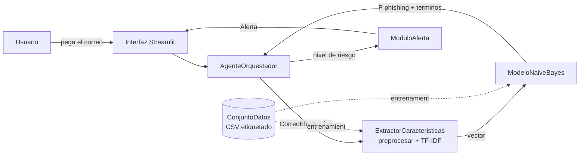
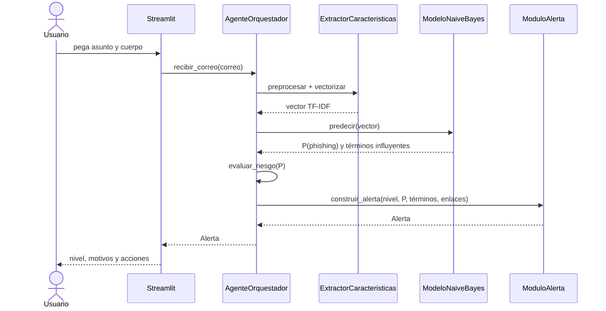

# Documento de diseño

Mecanismo inteligente para la detección, pronóstico y mitigación de phishing en correo electrónico.
Fase CRISP-DM: B.1–B.4 (comprensión del negocio hasta modelado). Este documento es la referencia para la implementación.

## 1. Alcance

El sistema recibe el texto de un correo, estima la probabilidad de que sea phishing, la traduce en un nivel de riesgo (bajo, medio, alto) y muestra al usuario una alerta con los motivos y las acciones recomendadas.

Dentro del alcance: clasificación sobre el texto del correo (asunto + cuerpo) y detección de enlaces, interfaz web local en Streamlit, métricas de evaluación.

Fuera del alcance (por ahora): integración con un cliente de correo real, análisis de adjuntos, correos en español, análisis de cabeceras SPF/DKIM.

## 2. Decisiones de diseño

| # | Decisión | Motivo | Alternativa descartada |
|---|---|---|---|
| D1 | Naive Bayes Multinomial + TF-IDF | Ligero, rápido de entrenar, interpretable; coherente con el anteproyecto (B.4.2) | Transformers: mejor desempeño reportado, pero fuera del plazo y menos explicables |
| D2 | Reemplazar URLs por el token `urltoken` en vez de borrarlas | La presencia de enlaces es señal fuerte y un modelo de palabras no la vería si se eliminan | Borrar URLs |
| D3 | El extractor se ajusta solo con entrenamiento y se guarda junto al modelo | Evita fuga de datos y desajuste entre entrenamiento y uso real | Re-ajustar en cada ejecución |
| D4 | Explicar la alerta con los términos que más aportan a la decisión | Cierra la brecha de explicabilidad de la sección II.C sin librerías extra | SHAP/LIME: más pesado para un modelo que ya es lineal |
| D5 | Umbrales de riesgo configurables en `config.py` | Se calibran con datos reales en evaluación | Umbrales fijos en el código |
| D6 | Etiquetas internas 0 = legítimo, 1 = malicioso (spam/phishing); el cargador falla si encuentra una etiqueta desconocida | Evita entrenar con etiquetas mal interpretadas sin darse cuenta | Adivinar el mapeo |
| D7 | Aviso de idioma (`idioma.py`, `orquestador.py`): si el correo no parece inglés, no se usa la probabilidad del modelo y la alerta lo advierte | El modelo solo vio inglés; un pedido legítimo en español obtuvo P = 0,93 (riesgo alto) | Mostrar el nivel sin advertencia |
| D8 | Reglas complementarias (`reglas.py`): enlaces (IP, «@», acortadores, marca suplantada, dominio distinto al del remitente), remitente que suplanta una marca, lenguaje de urgencia y petición de contraseñas o códigos, en inglés y español; suman puntos, solo pueden subir el nivel y se muestran como motivos | El modelo de palabras no ve remitente ni enlaces (el dataset vino sin URLs) y el Obj. 1 del anteproyecto los menciona; un phishing sin palabras típicas obtuvo P = 0,19 | Confiar solo en el modelo |
| D9 | Actualización con ejemplos nuevos etiquetados (`ModeloNaiveBayes.actualizar`, `scripts/actualizar_modelo.py`) mediante `partial_fit`; el vocabulario TF-IDF queda fijo | El Obj. 2 del anteproyecto pide que el modelo "pueda actualizarse al alimentarlo con nuevos ejemplos" | Modelo fijo entrenado una sola vez |

## 3. Dataset

Criterios: texto de correo etiquetado como phishing/legítimo, descarga gratuita, tamaño manejable en un portátil, idioma inglés.

| Opción | Qué sé (verificado) | Qué falta confirmar | Uso propuesto |
|---|---|---|---|
| **Kaggle: "Phishing Email Dataset"** (Alam, 2024) | Existe; otro estudio lo cita como fuente (MeAJOR, arXiv 2507.17978). En un trabajo de grado aparece como `Phishing_Email.csv` con columnas `Email Text` y `Email Type` | Número de filas, balance de clases, valores exactos de `Email Type`, licencia | **Principal** para entrenar y evaluar |
| **Zenodo: "Phishing validation emails dataset"** (v1, 2024) | Verificado (18 oct): archivo `Phishing_validation_emails.csv` de 203 kB (MD5 `1bf8ec0fe3f67e12dd275ce5b2b91b69`), columnas `Email Text` y `Email Type` (`Safe Email` / `Phishing Email`), licencia CC BY 4.0. Tiene 2.000 filas (1.000 por clase) pero solo **100 textos únicos**, cada uno repetido 20 veces; tras quitar duplicados quedan 100 correos (77 seguros y 23 phishing). <https://zenodo.org/records/13474746> | Origen de los textos (reales o generados); los ejemplos vistos parecen frases cortas tipo plantilla | **Validación externa**, con la salvedad de que 100 correos dan porcentajes con mucho margen de error |
| MeAJOR Corpus (arXiv 2507.17978) | 135.894 correos tras limpieza, fuentes Nazario, Nigerian Fraud y TREC-05/06/07, 20 columnas | Enlace de descarga y licencia no aparecen en el artículo | Opción de ampliación si el principal resulta pequeño o sesgado |

**Estado actual (17 oct):** se trabaja por ahora con `CEAS_08.csv`, uno de los archivos del dataset de Kaggle. Verificado con el propio archivo: 39.154 filas y 7 columnas (`sender`, `receiver`, `date`, `subject`, `body`, `label`, `urls`); `label` 1 = 21.842 y 0 = 17.312; `urls` 1 = 26.232 y 0 = 12.922. El CEAS 2008 es un corpus de spam contra correo legítimo, así que la clase 1 es "malicioso/no deseado" y no phishing en sentido estricto (por confirmar con las muestras que imprime `scripts/explorar_datos.py`). El informe debe describirlo con ese alcance. El cargador ya admite agregar más fuentes (por ejemplo, Nazario y Nigerian Fraud como clase mala) cuando se descarguen.

**Dataset de trabajo (actualización):** se adopta `phishing_email.csv` (Kaggle, combinación de varias fuentes). Verificado al explorarlo: 82.486 filas y 2 columnas (`text_combined`, `label`); tras limpiar quedan 82.077 correos (39.233 legítimos y 42.844 maliciosos; se quitó 1 texto vacío y 408 duplicados, más los de etiqueta contradictoria que reporte el script). Hallazgos de la exploración:

1. La clase 1 mezcla spam, "ensaladas de palabras" y estafas tipo *dear friend*; no es phishing en sentido estricto. El informe debe llamarla "correo malicioso o no deseado".
2. El texto ya viene preprocesado (minúsculas, sin puntuación, sin enlaces, correos mutilados como `pjaxqpythonorg`). Consecuencia: el token `urltoken` nunca aparece en el entrenamiento y el modelo no aprende nada de los enlaces. Si se quiere usar esa señal en la demo, hay que añadirla como regla del orquestador (por ejemplo, subir un nivel de riesgo si el correo trae enlaces a dominios que no coinciden con el remitente) y documentarlo como decisión aparte.
3. Se ven rasgos de la fuente (los legítimos parecen listas de correo con `wrote`, `list`, `pgp`; términos de fecha como `aug` y `wed` aparecen en ambas clases). `scripts/entrenar.py` imprime los términos más discriminantes para auditar esto.
4. Las muestras que imprime `scripts/explorar_datos.py` no contienen palabras vacías («the», «and», «to», «i»): el corpus parece traerlas ya eliminadas (verificado el 20 oct en una muestra de 5.000 correos: «the», «and», «to», «of» y «you» aparecen en el 0,0 % de ellos). Es otra diferencia entre el corpus y un correo real, y rompe el detector de idioma (`idioma.py`), que se apoya en esas palabras: sobre el 20 % de prueba concluyó «no es inglés» en el 99,3 % de los correos (16.302 de 16.416) y apagó el modelo, hundiendo la sensibilidad del mecanismo a 2,3 %. No era un fallo del modelo sino un detector aplicado fuera de su alcance; por eso `scripts/evaluar_mecanismo.py` evalúa ese corpus con `ConfigOrquestador(verificar_idioma=False)` y mantiene el filtro en el dataset externo.

Riesgo conocido: los corpus antiguos tienen artefactos propios de cada fuente (formato, cabeceras, época), y un modelo puede aprender esos rasgos en lugar del contenido malicioso, dando métricas altísimas que no se sostienen en correos nuevos. Por eso la validación externa con el dataset de Zenodo es parte del plan y no un extra.

Cómo conseguirlo: el entorno donde trabajo no puede descargar de Kaggle ni Zenodo, así que la descarga la haces tú una vez y dejas el CSV en `data/raw/`. El cargador (`ConjuntoDatos`) detecta las columnas por nombre y falla con un mensaje claro si no reconoce las etiquetas, así que si los valores de `Email Type` difieren de lo esperado lo veremos en el primer intento.

Antes de entrenar, en la fase B.2 hay que medir: filas totales, balance de clases, duplicados, longitud de textos. Si el dataset resulta muy desbalanceado se corrige con `class_weight`/submuestreo.

## 4. Arquitectura

Flujo en producción:

Mapa de clases del diagrama del anteproyecto a archivos:

| Clase (Fig. 1) | Archivo |
|---|---|
| CorreoElectronico | `src/phishing_detector/correo.py` |
| ConjuntoDatos | `src/phishing_detector/data.py` |
| ExtractorCaracteristicas | `src/phishing_detector/caracteristicas.py` |
| ModeloNaiveBayes | `src/phishing_detector/modelo.py` |
| AgenteOrquestador | `src/phishing_detector/orquestador.py` |
| ModuloAlerta | `src/phishing_detector/alerta.py` |

Nota: el anteproyecto dibuja una flecha "ModeloNaiveBayes → ModuloAlerta (clasifica)". En el diseño final el modelo no habla con el módulo de alerta: pasa siempre por el orquestador. Hay que actualizar la Fig. 1 del documento en la versión final.

## 5. Niveles de riesgo

| Nivel | Condición inicial | Significado |
|---|---|---|
| Bajo | P < 0,35 | Sin señales fuertes de phishing |
| Medio | 0,35 ≤ P < 0,70 | Señales mixtas, verificar antes de actuar |
| Alto | P ≥ 0,70 | Muy probable phishing, no interactuar |

Los umbrales son un punto de partida. En evaluación se ajustan sobre un conjunto de validación, priorizando que los phishing reales no se clasifiquen como bajo (sensibilidad), aceptando algunos falsos positivos.

**Cómo se obtiene el nivel que ve el usuario (`AgenteOrquestador.recibir_correo`):**

1. Se detecta el idioma (`idioma.py`). Si es inglés (o el texto es demasiado corto para saberlo), el modelo calcula P y se obtiene el *nivel del modelo* con la tabla anterior. Si no, no se usa el modelo y la alerta lo advierte.
2. Las reglas (`reglas.py`) suman puntos: 1 débil, 2 media, 3 fuerte. Con 2 o más puntos el nivel de las reglas es medio; con 4 o más, alto (`ConfigOrquestador.puntos_medio` y `puntos_alto`).
3. El nivel final es el más grave de los dos. Las reglas solo suben el nivel, nunca lo bajan.

Los puntos de cada regla y los cortes de 2 y 4 son un punto de partida elegido a mano, sin entrenar. Sus efectos se miden en `scripts/evaluar_mecanismo.py`, con dos límites que deben declararse en el informe: (1) el 20 % de prueba de `phishing_email.csv` es independiente de las reglas, pero llegó sin enlaces ni remitente, así que las reglas de enlaces y remitente no pueden dispararse y esa medida no prueba que ayuden; (2) el dataset de Zenodo **no es independiente**: al escribir las reglas de texto se vieron seis de sus filas, y las reglas `premio` y `datos_sensibles` coinciden con ellas, de modo que sus cifras son optimistas. La validación real de las reglas necesita correos con enlaces y remitente que no se hayan visto al escribirlas.

## 6. Textos de alerta (acciones sugeridas)

- **Alto:** no hacer clic en enlaces, no descargar adjuntos, no responder; verificar al remitente por otro canal; reportar el correo y eliminarlo.
- **Medio:** no hacer clic todavía; comprobar el dominio del remitente y hacia dónde apuntan los enlaces; ante la duda, tratarlo como alto.
- **Bajo:** sin señales fuertes; mantener la precaución habitual con enlaces y adjuntos inesperados.

Cada alerta incluye: probabilidad, los términos que más pesaron, y los enlaces encontrados.

## 7. Interfaz (Streamlit)

Una sola pantalla: cuadro de texto para pegar el correo, botón "Analizar", y debajo una tarjeta de color (verde, amarillo o rojo) con el nivel, la probabilidad, los términos sospechosos y las acciones. Una barra lateral con las métricas del modelo cargado y un aviso de que es un prototipo académico.

## 8. Plan de evaluación (B.5)

- Clasificación: precisión, sensibilidad, F1 y matriz de confusión en el 20 % de prueba.
- Probabilidad: MSE y R² como en el anteproyecto. Nota técnica: el MSE entre probabilidad y etiqueta 0/1 es el puntaje de Brier, y el R² resultante mide cuánta varianza de la etiqueta explica la probabilidad. Naive Bayes suele dar probabilidades extremas (cercanas a 0 o 1), así que si salen mal calibradas se prueba `CalibratedClassifierCV` antes de fijar los umbrales.
- Validación externa: probar el modelo entrenado en el dataset de Zenodo para ver cuánto generaliza.

### Resultados obtenidos (18 oct)

Corrida de `scripts/entrenar.py` sobre `phishing_email.csv` (82.077 correos limpios: 65.661 de entrenamiento y 16.416 de prueba; semilla 42; unos 75 s) y validación externa con `Phishing_validation_emails.csv`. Registros completos en `docs/resultados/`.

| Métrica | Prueba 20 % (n = 16.416) | Externo (n = 100) |
|---|---|---|
| Exactitud | 0,9642 | 0,7900 |
| Precisión | 0,9891 | 0,5250 |
| Sensibilidad | 0,9419 | 0,9130 |
| F1 | 0,9649 | 0,6667 |
| AUC-ROC | 0,9969 | 0,9193 |
| MSE (Brier) | 0,0271 | 0,1319 |
| R² de la probabilidad | 0,8914 | 0,2551 |
| Matriz (VN / FP / FN / VP) | 7.758 / 89 / 498 / 8.071 | 58 / 19 / 2 / 21 |
| Legítimos en nivel alto | 0,75 % | 12,99 % |
| Maliciosos en nivel bajo | 3,65 % | 8,70 % |

Lectura:

1. Dentro de su corpus el modelo separa muy bien las clases (AUC 0,997), pero los términos que más pesan son rasgos de las fuentes: hacia legítimo `enron`, `kaminski`, `pythondev`, `opensuse`; hacia malicioso `replica watches`, `rolex`, `custom alert` y enlaces de cnn.com. Aprendió el estilo del corpus más que el contenido del phishing.
2. Fuera del corpus la precisión baja de 98,9 % a 52,5 %: de 77 correos legítimos, 19 se marcaron como maliciosos. La sensibilidad se mantiene (21 de 23 phishing detectados) y la calibración empeora (R² de 0,89 a 0,26).
3. Con solo 23 correos de phishing, los porcentajes externos tienen mucho margen de error: indican una tendencia, no una medida precisa.
4. Aún no se ha probado `--calibrar` ni el ajuste de umbrales.

Pruebas manuales con correos escritos a mano (ilustrativas, no estadísticas; reproducibles con `scripts/probar_ejemplos.py`):

| Correo | P(malicioso) | Observación |
|---|---|---|
| Phishing PayPal (inglés) | 0,981 | Detectado |
| Phishing banco (inglés) | 0,963 | Detectado |
| Phishing en español | 0,968 | Acierta, pero casi ninguna palabra está en el vocabulario |
| Legítimo: reunión (inglés) | 0,009 | Correcto |
| Legítimo: pedido enviado (inglés) | 0,480 | Riesgo medio: falsa alarma |
| Legítimo: reunión (español) | 0,477 | Riesgo medio: falsa alarma |
| Legítimo: pedido enviado (español) | 0,928 | Riesgo alto: falsa alarma |
| Legítimo: extracto bancario (inglés) | 0,647 | Riesgo medio: falsa alarma |
| Phishing sin palabras típicas (pide un código por SMS) | 0,193 | Riesgo bajo: se le escapa |

Estos resultados motivan las decisiones D7 a D9 y se discuten en la fase de discusión de resultados.

### Evaluación del mecanismo completo (20 oct)

`scripts/evaluar_mecanismo.py` compara el modelo solo con el mecanismo (modelo + reglas + aviso de idioma), con el criterio «se alerta si el nivel es medio o alto». El 20 % de prueba se evalúa sin el filtro de idioma (el corpus no tiene palabras vacías; con el filtro se habrían descartado 16.302 de 16.416 correos). Registro completo en `docs/resultados/evaluacion_mecanismo.*`.

| Con alerta en nivel medio o alto | Prueba 20 %: solo modelo | Prueba 20 %: mecanismo | Externo (n = 100): solo modelo | Externo: mecanismo |
|---|---|---|---|---|
| Sensibilidad | 96,3 % | 96,4 % | 91,3 % | 91,3 % |
| Precisión | 98,4 % | 98,0 % | 46,7 % | 46,7 % |
| Falsas alarmas | 1,7 % | 2,1 % | 31,2 % | 31,2 % |

(La precisión externa de 52,5 % de la tabla anterior usa el corte de 0,5; aquí es 46,7 % porque el criterio incluye el nivel medio.)

Lectura:

1. **Las reglas no mejoran de forma medible.** En el 20 % de prueba la sensibilidad sube 0,1 puntos y las falsas alarmas suben 0,4 puntos; con el criterio «solo nivel alto» no cambia nada. En el dataset externo no cambian ningún nivel.
2. **La medida no puede ni confirmar ni descartar su utilidad.** Las reglas actúan sobre enlaces y remitente, y ninguno de los dos conjuntos los tiene (el corpus los eliminó; el externo son frases cortas). Lo que sí se observa es el costo: algunas falsas alarmas más por las reglas de texto.
3. **El filtro de idioma no se pudo medir en el corpus de entrenamiento.** En las pruebas manuales evita las falsas alarmas en español (2 casos, ilustrativo).
4. **El problema de fondo no cambia:** el mecanismo no mejora la generalización del modelo (precisión externa por debajo de 50 %).

## 9. Plan hasta el miércoles

| Día | Entregable |
|---|---|
| Sáb–Dom | Diseño aprobado, dataset descargado, cargador y preprocesamiento (B.2, B.3) |
| Dom–Lun | Entrenamiento y validación externa (B.4, B.5), hecho; orquestador, alertas, reglas e idioma, y actualización del modelo (B.6, D7–D9), hecho |
| Mar | Interfaz Streamlit (B.6), medir el mecanismo con `scripts/evaluar_mecanismo.py` y ajustar umbrales |
| Mié | Pruebas, README, informe de diseño e implementación |

## 10. Limitaciones conocidas

- Modelo entrenado solo con inglés: en español puede fallar sin avisar. La interfaz debe advertirlo.
- Bolsa de palabras: no entiende contexto ni suplantaciones sutiles; un ataque bien redactado puede salir como riesgo bajo.
- Los datasets públicos tienden a ser antiguos; los phishing actuales (incluidos los generados con IA) pueden no estar representados.
- La clase "maliciosa" de `phishing_email.csv` mezcla spam, estafas y texto sin sentido; el sistema detecta "correo malicioso o no deseado", no phishing en sentido estricto.
- Trabajo futuro: crear o conseguir un corpus de correos en español y reentrenar; añadir el análisis de enlaces y de cabeceras con datos reales.

## 11. Trazabilidad con el anteproyecto

| Anteproyecto | Componente del repositorio | Estado (18 oct) |
|---|---|---|
| Obj. 1, Detección: reconocer rasgos lingüísticos y técnicos (remitente, enlaces, palabras clave, urgencia) | TF-IDF sobre el texto (palabras clave); remitente, enlaces y urgencia mediante reglas del orquestador (D8) | Hecho (D8); medido sin efecto apreciable porque los conjuntos de evaluación no tienen enlaces ni remitente (sección 8) |
| Obj. 2, Pronóstico: probabilidad de phishing y modelo que se actualiza con nuevos ejemplos | `ModeloNaiveBayes.predecir`; reentrenamiento (D9) | Hecho, con el límite del vocabulario fijo |
| Obj. 3, Mitigación: alerta según el nivel de riesgo, con acciones recomendadas | `ModuloAlerta` y `AgenteOrquestador` (sección 6) | Alerta, orquestador e interfaz Streamlit (`app/app.py`) hechos |
| Resultado: dataset procesado | `ConjuntoDatos` | Hecho |
| Resultado: modelo entrenado con precisión, sensibilidad y F1 | `scripts/entrenar.py`, `evaluacion.py` | Hecho (además AUC, MSE y R²) |
| Resultado: mecanismo de alerta y mitigación | `AgenteOrquestador`, `ModuloAlerta`, interfaz Streamlit | Hecho |

Matices respecto al texto del anteproyecto, que deben declararse en el informe:

1. El anteproyecto habla de correos "de phishing y legítimos"; el dataset de entrenamiento mezcla spam y fraude (sección 3).
2. Se añaden elementos que el anteproyecto no pedía: explicabilidad (la referencia [1] recomienda IA explicable), validación externa, MSE y R² (sección B.5.1 de la versión final) y la interfaz Streamlit.
3. La Fig. 1 del anteproyecto dibuja una flecha del modelo al módulo de alerta; en el diseño final todo pasa por el orquestador (sección 4). Hay que corregir la figura en la versión final.
