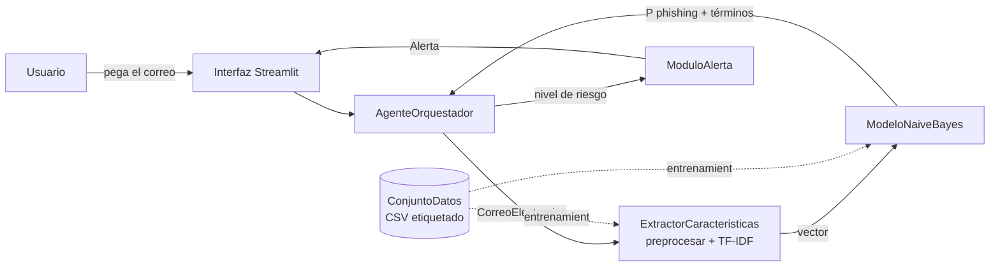
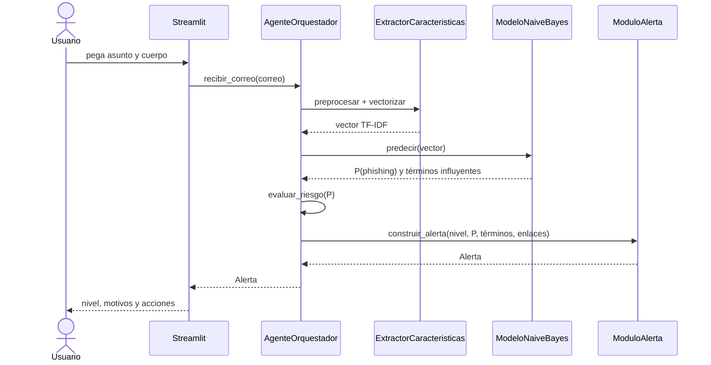

# Documento de diseño

Mecanismo inteligente para la detección, pronóstico y mitigación de phishing en correo electrónico.
Fase CRISP-DM: B.1–B.4 (comprensión del negocio hasta modelado). Este documento es la referencia para la implementación.

## 1. Alcance

El sistema recibe el texto de un correo, estima la probabilidad de que sea phishing, la traduce en un nivel de riesgo (bajo, medio, alto) y muestra al usuario una alerta con los motivos y las acciones recomendadas.

Dentro del alcance: clasificación sobre el texto del correo (asunto + cuerpo) y detección de enlaces, interfaz web local en Streamlit, métricas de evaluación.

Fuera del alcance (por ahora): integración con un cliente de correo real, análisis de adjuntos, correos en español, análisis de cabeceras SPF/DKIM.

## 2. Decisiones de diseño

| # | Decisión | Motivo | Alternativa descartada |
|---|---|---|---|
| D1 | Naive Bayes Multinomial + TF-IDF | Ligero, rápido de entrenar, interpretable; coherente con el anteproyecto (B.4.2) | Transformers: mejor desempeño reportado, pero fuera del plazo y menos explicables |
| D2 | Reemplazar URLs por el token `urltoken` en vez de borrarlas | La presencia de enlaces es señal fuerte y un modelo de palabras no la vería si se eliminan | Borrar URLs |
| D3 | El extractor se ajusta solo con entrenamiento y se guarda junto al modelo | Evita fuga de datos y desajuste entre entrenamiento y uso real | Re-ajustar en cada ejecución |
| D4 | Explicar la alerta con los términos que más aportan a la decisión | Cierra la brecha de explicabilidad de la sección II.C sin librerías extra | SHAP/LIME: más pesado para un modelo que ya es lineal |
| D5 | Umbrales de riesgo configurables en `config.py` | Se calibran con datos reales en evaluación | Umbrales fijos en el código |
| D6 | Etiquetas internas 0 = legítimo, 1 = malicioso (spam/phishing); el cargador falla si encuentra una etiqueta desconocida | Evita entrenar con etiquetas mal interpretadas sin darse cuenta | Adivinar el mapeo |

## 3. Dataset

Criterios: texto de correo etiquetado como phishing/legítimo, descarga gratuita, tamaño manejable en un portátil, idioma inglés.

| Opción | Qué sé (verificado) | Qué falta confirmar | Uso propuesto |
|---|---|---|---|
| **Kaggle: "Phishing Email Dataset"** (Alam, 2024) | Existe; otro estudio lo cita como fuente (MeAJOR, arXiv 2507.17978). En un trabajo de grado aparece como `Phishing_Email.csv` con columnas `Email Text` y `Email Type` | Número de filas, balance de clases, valores exactos de `Email Type`, licencia | **Principal** para entrenar y evaluar |
| **Zenodo: "Phishing validation emails dataset"** (v1, 2024) | 2.000 correos, dos clases (Safe Email / Phishing Email), un CSV de 203 kB, licencia CC BY 4.0. <https://zenodo.org/records/13474746> | Balance de clases, nombres de columnas | **Validación externa** y pruebas rápidas (mezcla correos reales y generados) |
| MeAJOR Corpus (arXiv 2507.17978) | 135.894 correos tras limpieza, fuentes Nazario, Nigerian Fraud y TREC-05/06/07, 20 columnas | Enlace de descarga y licencia no aparecen en el artículo | Opción de ampliación si el principal resulta pequeño o sesgado |

**Estado actual (17 oct):** se trabaja por ahora con `CEAS_08.csv`, uno de los archivos del dataset de Kaggle. Verificado con el propio archivo: 39.154 filas y 7 columnas (`sender`, `receiver`, `date`, `subject`, `body`, `label`, `urls`); `label` 1 = 21.842 y 0 = 17.312; `urls` 1 = 26.232 y 0 = 12.922. El CEAS 2008 es un corpus de spam contra correo legítimo, así que la clase 1 es "malicioso/no deseado" y no phishing en sentido estricto (por confirmar con las muestras que imprime `scripts/explorar_datos.py`). El informe debe describirlo con ese alcance. El cargador ya admite agregar más fuentes (por ejemplo, Nazario y Nigerian Fraud como clase mala) cuando se descarguen.

**Dataset de trabajo (actualización):** se adopta `phishing_email.csv` (Kaggle, combinación de varias fuentes). Verificado al explorarlo: 82.486 filas y 2 columnas (`text_combined`, `label`); tras limpiar quedan 82.077 correos (39.233 legítimos y 42.844 maliciosos; se quitó 1 texto vacío y 408 duplicados, más los de etiqueta contradictoria que reporte el script). Hallazgos de la exploración:

1. La clase 1 mezcla spam, "ensaladas de palabras" y estafas tipo *dear friend*; no es phishing en sentido estricto. El informe debe llamarla "correo malicioso o no deseado".
2. El texto ya viene preprocesado (minúsculas, sin puntuación, sin enlaces, correos mutilados como `pjaxqpythonorg`). Consecuencia: el token `urltoken` nunca aparece en el entrenamiento y el modelo no aprende nada de los enlaces. Si se quiere usar esa señal en la demo, hay que añadirla como regla del orquestador (por ejemplo, subir un nivel de riesgo si el correo trae enlaces a dominios que no coinciden con el remitente) y documentarlo como decisión aparte.
3. Se ven rasgos de la fuente (los legítimos parecen listas de correo con `wrote`, `list`, `pgp`; términos de fecha como `aug` y `wed` aparecen en ambas clases). `scripts/entrenar.py` imprime los términos más discriminantes para auditar esto.

Riesgo conocido: los corpus antiguos tienen artefactos propios de cada fuente (formato, cabeceras, época), y un modelo puede aprender esos rasgos en lugar del contenido malicioso, dando métricas altísimas que no se sostienen en correos nuevos. Por eso la validación externa con el dataset de Zenodo es parte del plan y no un extra.

Cómo conseguirlo: el entorno donde trabajo no puede descargar de Kaggle ni Zenodo, así que la descarga la haces tú una vez y dejas el CSV en `data/raw/`. El cargador (`ConjuntoDatos`) detecta las columnas por nombre y falla con un mensaje claro si no reconoce las etiquetas, así que si los valores de `Email Type` difieren de lo esperado lo veremos en el primer intento.

Antes de entrenar, en la fase B.2 hay que medir: filas totales, balance de clases, duplicados, longitud de textos. Si el dataset resulta muy desbalanceado se corrige con `class_weight`/submuestreo.

## 4. Arquitectura

Flujo en producción:

Mapa de clases del diagrama del anteproyecto a archivos:

| Clase (Fig. 1) | Archivo |
|---|---|
| CorreoElectronico | `src/phishing_detector/correo.py` |
| ConjuntoDatos | `src/phishing_detector/data.py` |
| ExtractorCaracteristicas | `src/phishing_detector/caracteristicas.py` |
| ModeloNaiveBayes | `src/phishing_detector/modelo.py` |
| AgenteOrquestador | `src/phishing_detector/orquestador.py` |
| ModuloAlerta | `src/phishing_detector/alerta.py` |

Nota: el anteproyecto dibuja una flecha "ModeloNaiveBayes → ModuloAlerta (clasifica)". En el diseño final el modelo no habla con el módulo de alerta: pasa siempre por el orquestador. Hay que actualizar la Fig. 1 del documento en la versión final.

## 5. Niveles de riesgo

| Nivel | Condición inicial | Significado |
|---|---|---|
| Bajo | P < 0,35 | Sin señales fuertes de phishing |
| Medio | 0,35 ≤ P < 0,70 | Señales mixtas, verificar antes de actuar |
| Alto | P ≥ 0,70 | Muy probable phishing, no interactuar |

Los umbrales son un punto de partida. En evaluación se ajustan sobre un conjunto de validación, priorizando que los phishing reales no se clasifiquen como bajo (sensibilidad), aceptando algunos falsos positivos.

## 6. Textos de alerta (acciones sugeridas)

- **Alto:** no hacer clic en enlaces, no descargar adjuntos, no responder; verificar al remitente por otro canal; reportar el correo y eliminarlo.
- **Medio:** no hacer clic todavía; comprobar el dominio del remitente y hacia dónde apuntan los enlaces; ante la duda, tratarlo como alto.
- **Bajo:** sin señales fuertes; mantener la precaución habitual con enlaces y adjuntos inesperados.

Cada alerta incluye: probabilidad, los términos que más pesaron, y los enlaces encontrados.

## 7. Interfaz (Streamlit)

Una sola pantalla: cuadro de texto para pegar el correo, botón "Analizar", y debajo una tarjeta de color (verde, amarillo o rojo) con el nivel, la probabilidad, los términos sospechosos y las acciones. Una barra lateral con las métricas del modelo cargado y un aviso de que es un prototipo académico.

## 8. Plan de evaluación (B.5)

- Clasificación: precisión, sensibilidad, F1 y matriz de confusión en el 20 % de prueba.
- Probabilidad: MSE y R² como en el anteproyecto. Nota técnica: el MSE entre probabilidad y etiqueta 0/1 es el puntaje de Brier, y el R² resultante mide cuánta varianza de la etiqueta explica la probabilidad. Naive Bayes suele dar probabilidades extremas (cercanas a 0 o 1), así que si salen mal calibradas se prueba `CalibratedClassifierCV` antes de fijar los umbrales.
- Validación externa: probar el modelo entrenado en el dataset de Zenodo para ver cuánto generaliza.

## 9. Plan hasta el miércoles

| Día | Entregable |
|---|---|
| Sáb–Dom | Diseño aprobado, dataset descargado, cargador y preprocesamiento (B.2, B.3) |
| Lun | Entrenamiento, evaluación y ajuste de umbrales (B.4, B.5) |
| Mar | Orquestador, alertas e interfaz Streamlit (B.6) |
| Mié | Pruebas, README, informe de diseño e implementación |

## 10. Limitaciones conocidas

- Modelo entrenado solo con inglés: en español puede fallar sin avisar. La interfaz debe advertirlo.
- Bolsa de palabras: no entiende contexto ni suplantaciones sutiles; un ataque bien redactado puede salir como riesgo bajo.
- Los datasets públicos tienden a ser antiguos; los phishing actuales (incluidos los generados con IA) pueden no estar representados.
